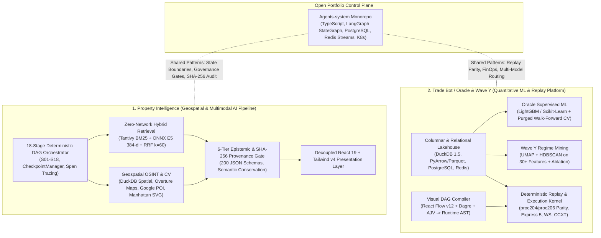

# Applied AI, RAG & Quantitative ML — Architecture Case Studies

**Author:** Ilia Miasnikov — Senior Software & AI Systems Architect (Valencia, Spain)  
**Scope:** System architecture blueprints, interactive C4/Mermaid diagrams, ML validation protocols, and sanitized JSON Schema contracts extracted from two private R&D repositories (`property_intelligence` and `trade_bot`), alongside the open [`Agents-system`](https://github.com/myasnikoviv/Agents-system) multi-agent monorepo.

> **Why this showcase exists:** Proprietary datasets, scraping targets, and quantitative trading configurations remain private. This repository publishes the **verifiable systems engineering** behind those projects: deterministic orchestration, anti-hallucination contracts, offline local hybrid RAG (`Tantivy + ONNX`), leakage-free `LightGBM` + `UMAP/HDBSCAN` pipelines, and visual DAG compilers.

---

## System Landscape



---

## Case Studies & Metrics Summary

| System | Domain & Problem Solved | Verified Codebase Scale | Core Stack | Key Architectural Patterns | Deep Dive |
| :--- | :--- | :--- | :--- | :--- | :--- |
| **1. Property Intelligence** | Multimodal real-estate audits & local hybrid RAG without LLM hallucination or external vector API drift | **255** Python scripts, **200** JSON Schemas, **563** test files (`pytest`), **28** ADRs | Python 3.11+, Tantivy 0.26.2, ONNX Runtime 1.31.0 (`multilingual-e5-small`), DuckDB Spatial, Shapely 2.0, Gemini Vision, Playwright CDP, React 19 | 18-stage DAG orchestrator with checkpointing, RRF (`k=60`) local hybrid search + Beam Search, 6-tier epistemic provenance, Manhattan camera calibration | [Case Study 01](case-studies/01-property-intelligence-geospatial-ai-pipeline.md) |
| **2. Trade Bot (`Oracle` & `Wave Y`)** | Leakage-free time-series ML validation, market regime discovery, and 1:1 execution replay parity | **24** TypeScript domain modules, **100+** Python ML/research tools, CI hardening gates | TypeScript 5.9, Node.js, Express 5, Python, LightGBM 4.6, Scikit-Learn 1.9, UMAP, HDBSCAN, DuckDB, PyArrow/Parquet, PostgreSQL, Redis, React Flow v12 | Purged Walk-Forward & Episode-Grouped CV, Challenger vs. Linear baselines, UMAP/HDBSCAN regime mining + counterfactual attribution, AST DAG compiler, `proc204`/`proc206` replay parity | [Case Study 02](case-studies/02-oracle-quantitative-ml-and-replay-platform.md) |

---

## Sanitized Contracts (`contracts/`)

1. [`contracts/epistemic-forensic-proposition.schema.json`](contracts/epistemic-forensic-proposition.schema.json) — Proposition-level output contract requiring explicit `epistemic_class`, `evidence_refs`, `status` (`OBSERVED | UNKNOWN | UNAVAILABLE`), `web_access: false`, and `causal_claim` flags.
2. [`contracts/hybrid-retrieval-bundle.schema.json`](contracts/hybrid-retrieval-bundle.schema.json) — Immutable bundle manifest for zero-network `Tantivy + ONNX` hybrid search, pinning Hugging Face blob SHA-256 digests, package versions, and Reciprocal Rank Fusion (`k=60`) fail-closed policy.

---

## Interactive Companion Web App (`Next.js 15 + Tailwind CSS v4 + next-intl + Zod`)

Run the visual architecture showcase locally:
```bash
npm install
npm run verify:atomic && npm run typecheck && npm run build
npm run dev
```
Open `http://localhost:3000/en`.
