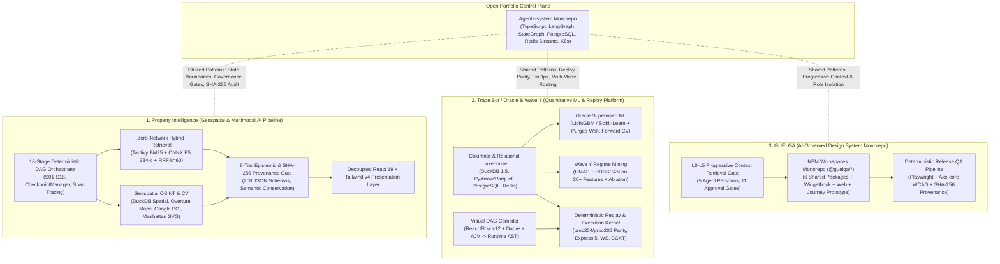

# Applied AI, Quantitative ML & Design Systems — Architecture Case Studies

**Author:** Ilia Miasnikov — Senior Software & AI Systems Architect (Valencia, Spain)  
**Scope:** Architectural blueprints, system boundaries, C4/Mermaid diagrams, and sanitized JSON Schema / Governance contracts extracted from three private R&D repositories (`property_intelligence`, `trade_bot`, `guelga`) alongside the open [`Agents-system`](https://github.com/myasnikoviv/Agents-system) monorepo.

> **Why this showcase exists:** Proprietary business logic, local market datasets, scraping targets, prompt bundles, and quantitative trading parameters remain private. This repository publishes the **verifiable systems engineering** behind those systems: deterministic orchestration, anti-hallucination validation contracts, zero-network hybrid retrieval, leakage-free ML evaluation, and progressive AI context governance.

---

## System Landscape

---

## Case Studies & Metrics Summary

| System | Domain & Problem Solved | Verified Codebase Scale | Core Stack | Key Architectural Patterns | Deep Dive |
| :--- | :--- | :--- | :--- | :--- | :--- |
| **1. Property Intelligence** | Multimodal real-estate intelligence & spatial layout generation without LLM hallucination or network drift | **255** Python scripts, **200** JSON Schemas, **563** test files (`pytest`), **28** ADRs | Python 3.11+, Tantivy 0.26.2, ONNX Runtime 1.31.0 (`multilingual-e5-small`), DuckDB Spatial, Shapely 2.0, Gemini Vision, Playwright CDP, React 19 | 18-stage DAG orchestrator with checkpointing, RRF (`k=60`) local hybrid search + Beam Search, 6-tier epistemic provenance, Manhattan camera calibration | [Case Study 01](case-studies/01-property-intelligence-geospatial-ai-pipeline.md) |
| **2. Trade Bot (`Oracle` & `Wave Y`)** | Leakage-free time-series ML validation, market regime discovery, and 1:1 execution replay parity | **24** TypeScript domain modules, **100+** Python ML/research tools, CI hardening gates | TypeScript 5.9, Node.js, Express 5, Python, LightGBM 4.6, Scikit-Learn 1.9, UMAP, HDBSCAN, DuckDB, PyArrow/Parquet, PostgreSQL, Redis, React Flow v12 | Purged Walk-Forward & Episode-Grouped CV, Challenger vs. Linear baselines, UMAP/HDBSCAN regime mining + counterfactual attribution, AST DAG compiler, `proc204`/`proc206` replay parity | [Case Study 02](case-studies/02-oracle-quantitative-ml-and-replay-platform.md) |
| **3. GÜELGA** | Preventing AI context rot & style drift across a multi-app React 19 design system | **6** NPM packages, **3** React apps, **11** Approval Gates, **70** engineering tickets | React 19, TypeScript, Vite, Design Tokens (JSON/CSS), Motion, SVG Sprite, i18n (`EN/ES/AST`), Playwright, Axe-core | `L0–L5` Progressive Context Retrieval Gate, 5-persona role routing, Journey Continuity State Graph, byte-identical SVG & WCAG release QA | [Case Study 03](case-studies/03-guelga-design-system-and-context-governance.md) |

---

## Sanitized Contracts & Governance Specs (`contracts/`)

Representative sanitized contracts showing how invariants are enforced structurally in code rather than through prompt instructions alone:

1. [`contracts/epistemic-forensic-proposition.schema.json`](contracts/epistemic-forensic-proposition.schema.json) — Proposition-level output contract requiring explicit `epistemic_class`, `evidence_refs`, `status` (`OBSERVED | UNKNOWN | UNAVAILABLE`), `web_access: false`, and `causal_claim` flags.
2. [`contracts/hybrid-retrieval-bundle.schema.json`](contracts/hybrid-retrieval-bundle.schema.json) — Immutable bundle manifest for zero-network `Tantivy + ONNX` hybrid search, pinning Hugging Face blob SHA-256 digests, package versions, and Reciprocal Rank Fusion (`k=60`) fail-closed policy.
3. [`contracts/l0-l5-context-retrieval-policy.json`](contracts/l0-l5-context-retrieval-policy.json) — Progressive context retrieval gate (`L0`–`L5`) separating design principles, canonical demonstrations, frozen implementation tokens, specialist QA, and excluded build noise (`L6`).

---

## Cross-Cutting Engineering Principles

1. **Deterministic control flow wraps probabilistic models:** LLMs and vision models act strictly as bounded stage workers inside typed Python/TypeScript state machines, never as unbounded outer loops.
2. **Fail-closed contracts & provenance over prompt hoping:** Missing external data remains explicitly `UNKNOWN` or `UNAVAILABLE`; every factual claim or dataset row traces back to a cryptographic `SHA-256` digest.
3. **Pure presentation boundaries:** React frontends consume pre-validated view-model JSON artifacts or compiled ASTs and perform zero business inference or direct external scraping in the browser.
4. **Leakage-proof evaluation:** Whether validating retrieval facets (`Property Intelligence`), time-series ML (`Oracle`/`Wave Y`), or UI accessibility (`GÜELGA`), evaluation harnesses run offline on pinned snapshots with explicit embargo/ablation controls.
