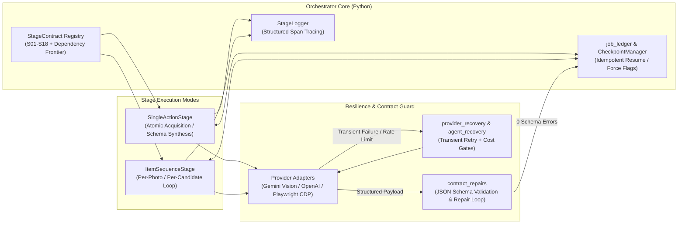
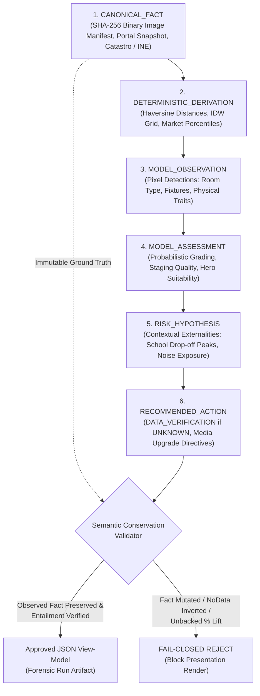
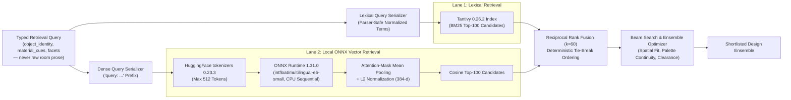
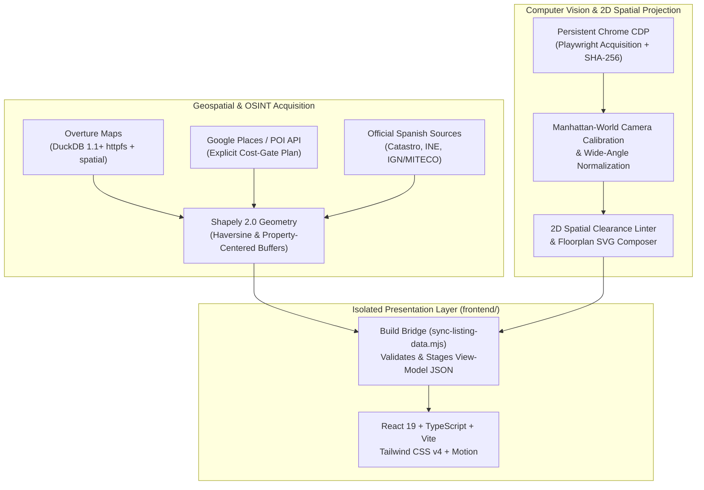

# Case Study 01: Property Intelligence — Geospatial, Multimodal Vision & Hybrid Retrieval AI Pipeline

**Role:** Systems & AI Architect  
**Codebase Scale (Private R&D Repo):** `255` Python scripts · `130+` orchestration modules · `66` interior-retrieval & layout modules · `200` JSON Schema contracts · `563` automated test files (`pytest`/`unittest`) · `28` Architecture Decision Records (ADRs) · Decoupled `React 19 + TypeScript` UI

---

## 1. The Engineering Problem

Real-estate intelligence and automated listing enrichment combine three failure-prone domains:
1. **Unstructured visual & portal evidence:** wide-angle distortion on listing photos, redundant/missing rooms, watermarks, and mismatched attributes between broker prose and actual pixels.
2. **Heterogeneous geospatial OSINT:** reconciling official government endpoints (Cadastre, census income, flood/noise rasters) with crowd/open maps (`Overture Maps`, `Google Places`) where missing data (`NoData`) must never be hallucinated as "safe" or "quiet."
3. **LLM hallucination & schema drift:** asking an end-to-end LLM agent to inspect photos, read neighborhood metrics, and produce an audit leads to silent fact mutation (e.g., flipping Energy Certificate `G` to `UNKNOWN`, inventing CTR lift percentages, or fabricating square footage).

**Architectural Solution:** Decouple deterministic acquisition, geospatial math, local hybrid search, and semantic verification from bounded multimodal LLM calls inside an **18-stage DAG orchestrator** governed by **200 JSON Schema contracts**.

---

## 2. Diagram 1: 18-Stage Deterministic DAG Orchestrator (`S01`–`S18`)

All execution is modeled around explicit stage contracts (`SingleActionStage` and `ItemSequenceStage`), fine-grained checkpointing (`CheckpointManager`), span-level observability (`StageLogger`), and typed recovery paths.

---

## 3. Diagram 2: 6-Tier Epistemic Hierarchy & Semantic Conservation Gate

To eliminate silent hallucinations, every downstream claim must declare an explicit `epistemic_class`, `status`, and cryptographic `SHA-256` provenance pointer. Any model output that contradicts an upstream observed fact or asserts an unbacked numeric lift fails deterministically before reaching the UI.

**Enforced Epistemic Invariants:**
* **Zero-Web-Access Inference:** During Layer-2 synthesis, `model_metadata.web_access` is locked to `false`; the model only reasons over the pinned snapshot bundle.
* **Negative-Evidence Preservation:** Raster `NoData` (e.g., flood `GRAY_INDEX: 999`) or offline public APIs remain `UNKNOWN` / `UNAVAILABLE` and can never be inverted into "no flood risk" or "quiet street."
* **Temporal Provenance:** Socioeconomic statistics must retain dataset reference period metadata (e.g., `INE ADRH 2023`).

---

## 4. Diagram 3: Zero-Network Local Hybrid Retrieval & Ensemble Optimizer

For product/furniture matching and staging workflows, calling hosted vector databases or external embedding APIs introduced latency, cost, and non-determinism. Instead, a **source-bound local hybrid retrieval bundle** executes completely offline inside Python.

**Production Hardening Details:**
* **Immutable Model Cache Verification:** Before loading `onnx/model.onnx`, the index builder resolves Hugging Face's content-addressed `blobs/` cache and asserts exact `SHA-256` equality for `model.onnx`, `tokenizer.json`, `config.json`, and `tokenizer_config.json`, as well as pinned versions of `tantivy`, `onnxruntime`, and `tokenizers`.
* **Fail-Closed Hybrid Policy:** `lexical_only_fallback` and `model_provider_fallback` are both hardcoded to `false` (`contracts/hybrid-retrieval-bundle.schema.json`). If either lane is unavailable, the retrieval stage fails closed rather than silently degrading search quality.
* **Ablation-Driven Tuning:** Offline benchmarks (`benchmark_catalogue_retrieval_engine.py`, `benchmark_catalogue_typed_facet_ablation.py`) measure each facet's marginal recall contribution against frozen human judgments.

---

## 5. Diagram 4: Geospatial OSINT, Computer Vision & Decoupled React 19 UI

**Decoupled UI Boundary:** The `frontend/` React 19 application has zero runtime access to scrapers, LLM SDKs, or collector internals. It is strictly a pure renderer over validated view-model JSON artifacts, verified by automated token and diagnosis profile tests.
