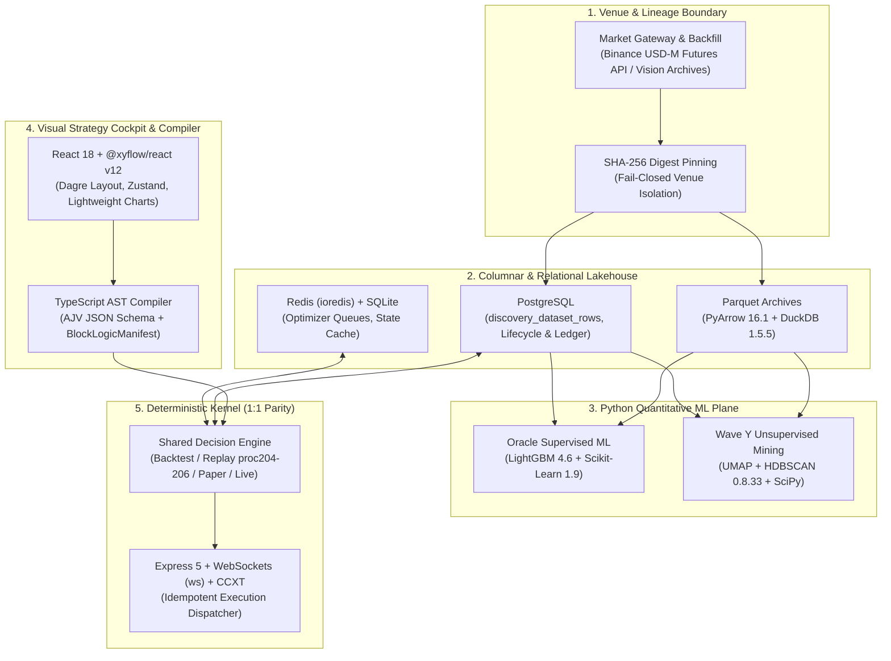
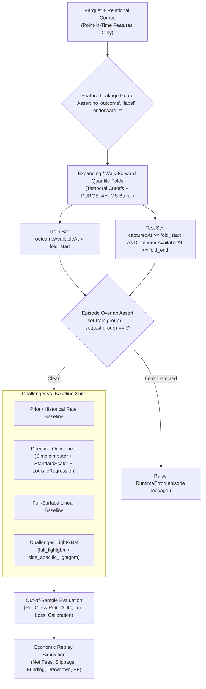
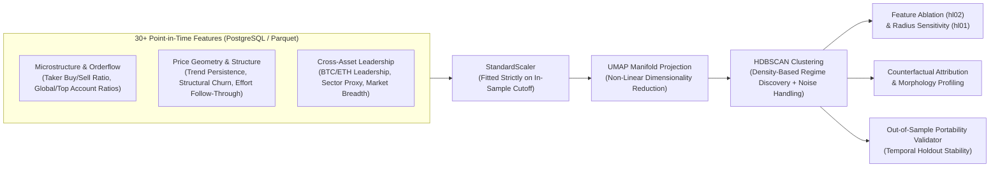
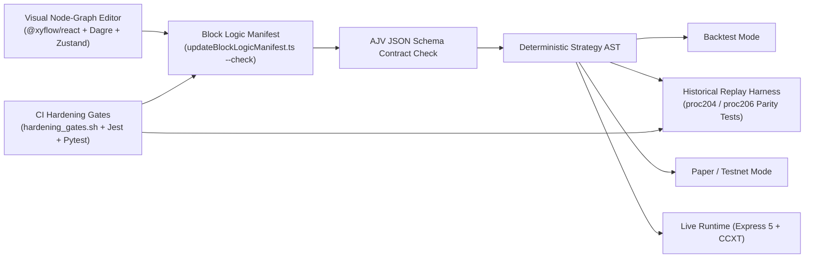

# Case Study 02: Oracle & Wave Y — Quantitative ML Research, Visual DAG Compiler & Deterministic Replay Platform

**Role:** Principal Systems & ML Infrastructure Engineer  
**Codebase Scale (Private R&D Repo `trade_bot`):** `24` TypeScript domain modules (`src/`) · `100+` Python ML & research tools (`src/tools/`) · `React 18 + React Flow v12` visual strategy cockpit · CI hardening & replay parity harnesses

> **Scope & Accuracy Note:** This case study documents the **ML methodology, leakage prevention controls, data engineering stack, visual DAG compiler, and deterministic execution parity** built in the platform. Proprietary alpha configurations remain private, and no live financial return claims are made.

---

## 1. The Engineering Problem

Most algorithmic research codebases collapse under four structural failure modes:
1. **Lookahead & Episode Leakage:** Standard k-fold cross-validation leaks overlapping forward outcome windows across train/test splits, inflating backtest metrics that immediately fail out-of-sample.
2. **Backtest-to-Live Execution Drift:** Writing strategy research in notebooks (`Python`) and rewriting execution logic separately (`TypeScript`/`Node.js`) creates subtle indicator, rounding, and order-lifecycle divergences.
3. **Opaque "Black-Box" ML Without Economic Baselines:** Deploying gradient-boosted trees without calibrated linear benchmarks, feature ablation, or fee/slippage/funding simulation masks whether non-linear complexity adds real signal.
4. **Regime Non-Stationarity:** Treating heterogeneous market structures (trend persistence vs. structural churn vs. volatility compression) with a single static threshold degrades signal quality across cycles.

---

## 2. Diagram 1: End-to-End Hybrid Platform Architecture

The platform bridges a **TypeScript/Node.js execution & compilation plane** with a **Python columnar ML plane** over a unified source-verified data lakehouse.

---

## 3. Diagram 2: `Oracle` Purged Walk-Forward & Episode-Grouped Validation Pipeline

To guarantee zero temporal or episode leakage when training `LightGBM` (`LGBMClassifier`, `LGBMRegressor`) and `Scikit-Learn` models (`LogisticRegression`, `StandardScaler`, `SimpleImputer`), every feature row carries explicit causality timestamps (`capturedAt`, `outcomeAvailableAt`) and an episode identifier (`symbol|episodeId`).

**Why This Pattern Matters:**
* **Strict Causality Boundary:** No training observation whose outcome becomes known after `fold_start` can enter a fold's training set, and `set(train.group) & set(test.group)` is checked programmatically before fitting.
* **Challenger Accountability:** `LightGBM` (`max_depth=3, num_leaves=8` constrained complexity to prevent overfitting) must prove statistically meaningful lift over regularized `LogisticRegression` on both probability calibration (`log_loss`) and net-of-cost replay before any promotion decision.

---

## 4. Diagram 3: `Wave Y` Unsupervised Market Regime Discovery

Rather than hand-coding arbitrary regime rules, `Wave Y` projects 30+ engineered microstructural and cross-asset features into a density-clustered manifold and tests whether discovered clusters persist out-of-sample.

---

## 5. Diagram 4: Visual DAG Compiler, Execution Parity & Multi-Agent Governance

**Core Operational Invariants:**
1. **Single Decision Kernel:** Mode differences live exclusively in clock, broker, and diagnostics adapters—never in strategy decision math.
2. **Contract-Driven Promotion Ladder:** `hypothesis -> historical evidence -> replay parity -> paper/sandbox -> limited live`.
3. **Structured AI Research Governance (`Luna` / `Sol`):** Bounded coding/verification tickets enforce editable-path allowlists, frozen evaluation contracts, and `SHA-256` cold-archive verification (`report_archive.py`) for generated Parquet/JSON evidence.
