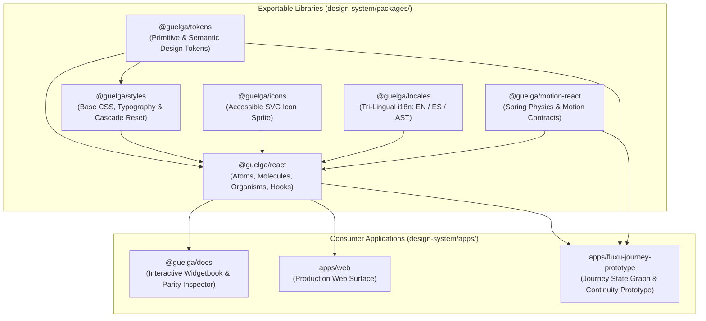
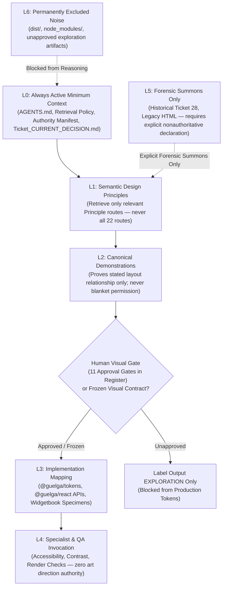
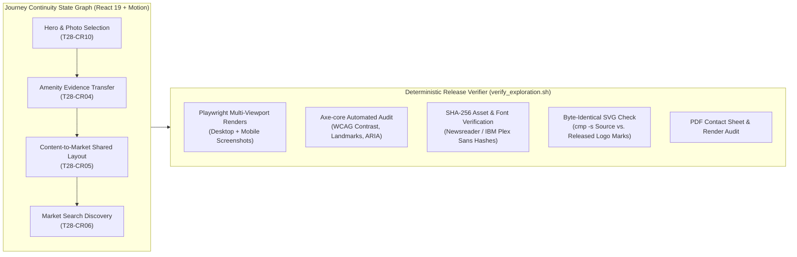

# Case Study 03: GÜELGA — AI-Governed Design System Monorepo & Progressive Context Architecture

**Role:** Design System & AI Governance Architect  
**Codebase Scale (Private R&D Repo `guelga`):** `6` NPM Workspace packages (`@guelga/*`) · `3` React 19 applications (including interactive Widgetbook & Journey State Graph prototype) · `11` formal Approval Gates · `70` tracked engineering tickets (`DS-R01`..`DS-R56`, `T28-CR01`..`T28-CR14`) · Automated `Playwright` + `Axe-core` + `SHA-256` release verification

---

## 1. The Engineering Problem

When using AI coding agents to build a multi-application design system and digital brand platform, teams quickly hit two failure modes:
1. **Context Window Pollution ("Context Rot"):** Giving an agent unrestricted access to an entire repository of historical audits, superseded prototypes, and generic UI skills causes the model to average out contradictory drafts and collapse into generic AI SaaS templates.
2. **Governance & Parity Drift:** Components documented in static HTML or Figma diverge from live React implementations, accessibility regresses silently, and generated assets overwrite verified vector geometry.

**Architectural Solution:** Pair a strictly typed **NPM Workspaces React 19 Design System Monorepo (`@guelga/*`)** with a formal **`L0–L5` Progressive Context Retrieval Policy** and a deterministic **Release QA Pipeline**.

---

## 2. Diagram 1: NPM Workspaces Design System Monorepo (`@guelga/*`)

---

## 3. Diagram 2: `L0–L5` Progressive AI Context Retrieval Gate & Role Routing

Before any design or implementation task executes, `GUELGA_DESIGN_RETRIEVAL_POLICY_v1.json` restricts which repository layers the AI agent is permitted to load, enforcing strict separation between brand judgment (`L1–L2`), human approval gates, and code implementation (`L3`).

**5-Persona Role Routing (`process/agents/`):**
* `brand-strategist` (positioning, voice, brand architecture)
* `art-director` (visual territories, materiality, imagery direction)
* `ui-ux-designer` (information architecture, interaction, WCAG accessibility)
* `design-system-engineer` (tokens, React packages, Widgetbook parity)
* `qa-editor` (evidence, typography, render parity, release sign-off)

One role leads each ticket while downstream roles act as reviewers, preventing simulated self-approval within a single agent turn.

---

## 4. Diagram 3: Journey Continuity State Graph & Release QA Pipeline

In `apps/fluxu-journey-prototype` (Tickets `T28-CR01`..`T28-CR14`) and the release verification script (`verify_exploration.sh`), state transitions and release artifacts undergo deterministic automated verification:

**Key Engineering Outcomes:**
* **Zero Silent Regressions:** Any accidental modification to licensed typography binaries, logo mark Bézier geometry, or ARIA attributes fails the release gate immediately (`FAIL` exit status).
* **Skill Isolation:** Generic external design/frontend skills are explicitly scoped as `implementation_or_mapping_only` or `qa_only`, ensuring they can accelerate React/CSS execution without overriding brand constitution or token contracts.
