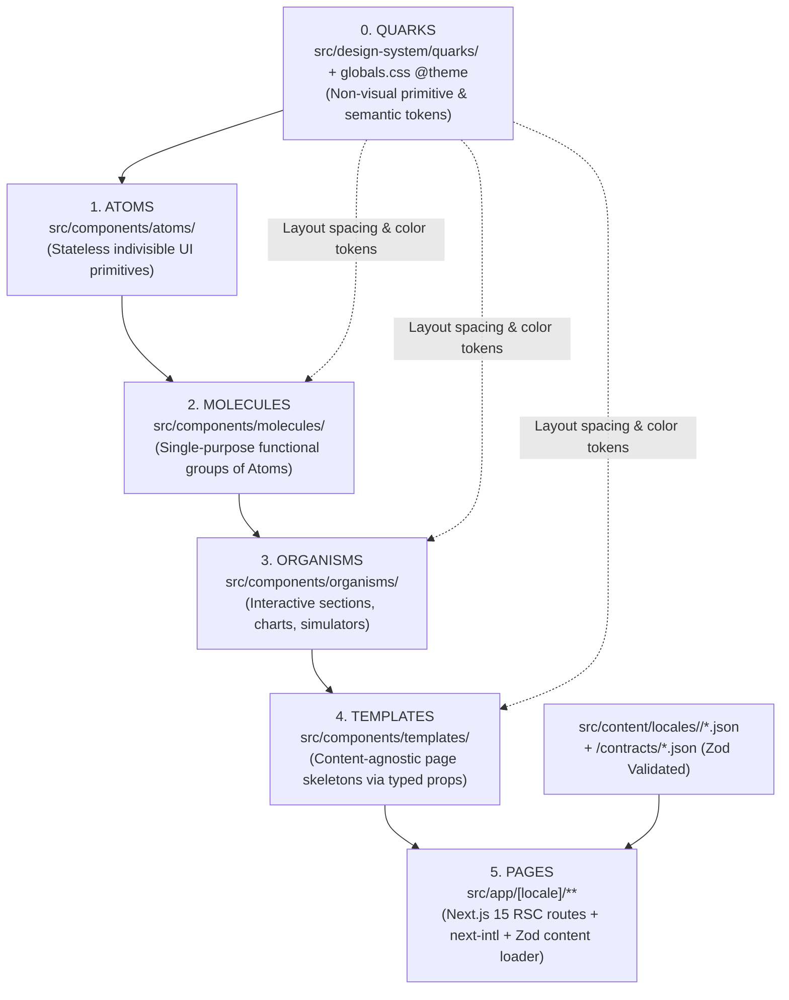

# Atomic Design System Specification (`Architecture-showcase`)

**Methodology:** 6-Stage Extended Atomic Design (`0. Quarks -> 1. Atoms -> 2. Molecules -> 3. Organisms -> 4. Templates -> 5. Pages`) governed by the locally installed [`.agents/skills/atomic-design-*`](../.agents/README.md) and [`design-system/architecture-showcase/MASTER.md`](../design-system/architecture-showcase/MASTER.md) (generated via `ui-ux-pro-max`).  
**Target Stack:** `Next.js 15` (App Router) · `React 19` · `TypeScript 5` · `Tailwind CSS v4` (`@theme`) · `next-intl` · `Zod` · `motion` · `lucide-react` · `shiki`

---

## 1. Strict Dependency & Import Architecture

Components may **only** import downward in the hierarchy. Peer imports within the same layer (for example, Molecule importing another Molecule, or Atom importing another Atom) and hardcoded copy strings inside UI components are forbidden.



### Non-Negotiable Boundaries
1. **Zero Raw Hex / Magic Spacing in Components:** All colors, radii, fonts, spacing, and motion durations come strictly from Level 0 Quarks (`Tailwind v4 @theme` CSS variables).
2. **Zero Hardcoded UI Copy:** Atoms, Molecules, Organisms, and Templates receive every string, label, chart dataset, and GitHub link via typed props resolved at the **Page** level through `next-intl` + `Zod`.
3. **Accessibility First (`ui-ux-pro-max` Priority 1–2):** All interactive buttons/tabs enforce `min-h-11 min-w-11` (`44x44px` hit target), visible `#38BDF8` focus rings, keyboard navigation (`ArrowLeft`/`ArrowRight` on tablists), `aria-hidden="true"` on decorative SVGs, and `prefers-reduced-motion` immediate final-state rendering.
4. **Dual-Encoded Charts & Visuals:** Every interactive chart pairs color with direct labels, distinct point shapes, or SVG patterns — never color alone.

---

## 2. Level 0: Quarks (Sub-Atomic Design Tokens & Tailwind v4 `@theme`)

Quarks render nothing on their own. They live in `src/design-system/quarks/` as TypeScript constants and in `src/app/globals.css` as Tailwind CSS v4 `@theme` custom properties.

### 2.1 Color Quarks (`quarks/colors.ts` & `--color-*`)

| Token Name | Hex Value | Semantic Role | Contrast Pair |
| :--- | :--- | :--- | :--- |
| `--color-canvas` | `#020617` | Root page background | Paired with `#F8FAFC` (`19.8:1` AAA) |
| `--color-surface-1` | `#0F172A` | Primary elevated section / control surface | Paired with `#F8FAFC` (`17.6:1` AAA) |
| `--color-card` | `#0E1223` | Bento card & inspector panel background | Paired with `#F8FAFC` (`18.1:1` AAA) |
| `--color-muted` | `#1A1E2F` | Code block chrome, inactive pills, track fills | Paired with `#94A3B8` (`6.7:1` AA+) |
| `--color-fg` | `#F8FAFC` | Primary headings & body copy | — |
| `--color-fg-muted` | `#94A3B8` | Subtitles, metadata, schema captions | — |
| `--color-border-subtle` | `#1E293B` | Hairline grid dividers | — |
| `--color-border-strong` | `#334155` | Interactive card borders & tab underlines | — |
| `--color-ring` | `#38BDF8` | Keyboard focus indicator (`focus-visible`) | — |
| `--color-accent-run` | `#22C55E` | Primary CTA, `PASS` state, `Permitted` layer | Paired with `#0F172A` (`7.9:1` AAA) |
| `--color-warn` | `#F59E0B` | `UNKNOWN` state, `Gated` layer, repair loop | Paired with `#0F172A` (`8.7:1` AAA) |
| `--color-reject` | `#EF4444` | `FAIL-CLOSED`, data leakage warning, `Blocked` | Paired with `#FFFFFF` / `#020617` |
| `--color-system-pi` | `#6366F1` | Identity accent for `01. Property Intelligence` | — |
| `--color-system-oracle` | `#06B6D4` | Identity accent for `02. Oracle & Wave Y` | — |
| `--color-system-guelga` | `#F59E0B` | Identity accent for `03. GÜELGA` | — |

### 2.2 Typography Quarks (`quarks/typography.ts` & `--font-*`)

* **`--font-mono`**: `'JetBrains Mono', ui-monospace, monospace` — used for system IDs (`01 / PROPERTY INTELLIGENCE`), metric counters (`tabular-nums`), stage IDs (`S01..S18`), SHA-256 hashes, JSON schemas, and status badges.
* **`--font-sans`**: `'IBM Plex Sans', system-ui, sans-serif` — used for problem narratives, subsystem explanations, and interactive tooltips.
* **Fluid Modular Scale:**
  * `display-lg`: `clamp(2.25rem, 4vw, 3.25rem)` / `line-height: 1.1` / `tracking: -0.025em` (`H1`)
  * `heading-lg`: `1.875rem` (`30px`) / `line-height: 1.2` (`Section Headings`)
  * `heading-md`: `1.25rem` (`20px`) / `line-height: 1.35` (`Subsystem Titles`)
  * `body-md`: `1rem` (`16px`) / `line-height: 1.6` (`Narrative Copy`, minimum `16px` base)
  * `mono-sm`: `0.8125rem` (`13px`) / `line-height: 1.45` (`CodeTokens`, `Badges`, `Axis Labels`)
  * `mono-xs`: `0.75rem` (`12px`) / `line-height: 1.4` (`Hash Pointers` — never below `12px`)

### 2.3 Spacing, Radii, Shadows, Motion & Breakpoint Quarks

* **Spacing Scale (Density 6/10 Standard):** `xs: 4px`, `sm: 8px`, `md: 16px`, `lg: 24px`, `xl: 32px`, `2xl: 48px`, `3xl: 64px`, `section: 96px`.
* **Radii:** `sm: 6px` (pills/badges), `md: 8px` (buttons/inputs), `lg: 12px` (Bento cards), `xl: 16px` (simulator stages/modals), `full: 9999px` (status dots).
* **Motion Quarks (`quarks/motion.ts`):**
  * `duration.fast: 150ms` (pill hover, tab highlight)
  * `duration.base: 250ms` (panel reveal, card border transition)
  * `duration.step: 400ms` (DAG stage packet step, fold scrubber)
  * `easing.standard: [0.22, 1, 0.36, 1]`
  * `reducedMotionFallback`: instant state transitions (`duration: 0`) when `prefers-reduced-motion: reduce`.
* **Breakpoints:** `sm: 375px`, `md: 768px`, `lg: 1024px`, `xl: 1280px`, `2xl: 1440px`.

---

## 3. Level 1: Atoms (`src/components/atoms/`)

Atoms import **only Quarks** (`forwardRef` pattern, typed props, zero internal business state).

| Atom Component | Responsibility & Variants | Key Props |
| :--- | :--- | :--- |
| `Heading` | Semantic `h1`–`h4` with mono/sans font switch | `as`, `size`, `font`, `children` |
| `Text` | Body prose, lead paragraph, muted caption | `variant` (`lead \| body \| muted \| mono`), `children` |
| `Button` | Action control (`44x44px` min hit area, `cursor-pointer`) | `variant` (`primary \| secondary \| ghost`), `size`, `leftIcon`, `rightIcon`, `asChild` |
| `StatusPill` | Verification badge (`PASS`, `FAIL-CLOSED`, `UNKNOWN`, `OBSERVED`, `GATED`) | `tone` (`run \| warn \| reject \| neutral \| system`), `icon`, `label` |
| `TechTag` | Interactive filter pill for Tech & Pattern Explorer | `label`, `systemAccent`, `isActive`, `onClick` |
| `Icon` | `lucide-react` wrapper enforcing consistent stroke & `aria-hidden` | `name`, `size`, `decorative`, `ariaLabel` |
| `SurfaceCard` | Bento container atom with optional system accent top/left border | `elevation` (`base \| elevated`), `accent` (`none \| pi \| oracle \| guelga`), `padding` |
| `CodeToken` | Inline monospace token / symbol / stage ID chip (`S01`, `PURGE_4H_MS`) | `children`, `tone` |
| `ShaDigestBadge` | Truncated cryptographic digest chip (`sha256:6142...18b3`) with copy state | `digest`, `label` |
| `MetricNumber` | Large `tabular-nums` counter (`200`, `563`, `18`, `30+`, `6`) | `value`, `accent` |
| `Divider` | Subtle `1px` structural separator | `orientation` (`horizontal \| vertical`) |

---

## 4. Level 2: Molecules (`src/components/molecules/`)

Molecules compose **Atoms + Quarks only** for one cohesive UI responsibility.

| Molecule Component | Composed Atoms | Purpose in Architecture Showcase |
| :--- | :--- | :--- |
| `MetricStatCard` | `SurfaceCard` + `MetricNumber` + `Heading` + `Text` | Hero 5-metric proof counters (`200` Schemas, `563` Tests, etc.) |
| `TechFilterGroup` | `Heading` + row of `TechTag` atoms | One category of the Tech & Pattern Explorer (e.g., *ML & Quantitative Validation*) |
| `SubsystemTabStrip` | Accessible `role="tablist"` of `Button` + `CodeToken` | Switches between the 3–4 subsystem tabs inside each system section |
| `DagStageNode` | `SurfaceCard` + `CodeToken` + `Text` + `StatusPill` | Single node (`S01`..`S18`, `Validator`, `Checkpoint`) inside Animation 4A |
| `EpistemicTierRow` | `CodeToken` (Tier `1..6`) + `StatusPill` + `Text` + `ShaDigestBadge` | Row inside Widget 4C showing `CANONICAL_FACT` -> `ACTION` entailment |
| `FoldSplitBar` | Proportional segments + `CodeToken` + `StatusPill` | One Walk-Forward CV fold bar (`Train` / `PURGE_4H_MS` hatch / `Test`) in Animation 5A |
| `ContextLayerRow` | `CodeToken` (`L0..L6`) + `Text` + `StatusPill` (`Permitted \| Gated \| Blocked`) | Row inside Animation 6A (`L0–L5` Context Retrieval Gate Simulator) |
| `GitHubArtifactLink` | `Icon` (`FileCode` / `GitBranch`) + `CodeToken` + `Text` + `Icon` (`ArrowUpRight`) | Direct deep-link pill to `case-studies/*.md` and `contracts/*.json` on GitHub |
| `ChartLegendToggle` | `Button` + SVG shape swatch + `Text` | Keyboard-focusable series toggle with shape + color indicator |
| `QaGateItem` | `Icon` (`CheckCircle2`) + `Text` + `CodeToken` | Row in `GÜELGA` Release QA Scorecard (`Playwright`, `Axe-core`, `cmp -s`, `SHA-256`) |

---

## 5. Level 3: Organisms (`src/components/organisms/`)

Organisms combine **Molecules + Atoms** into complete, stateful interactive sections matching `docs/landing-page-spec.md`.

| Organism | Contained Molecules & Interactive Visuals | Section Mapping |
| :--- | :--- | :--- |
| `ShowcaseHeader` | Brand mark, jump links, `GitHub Showcase` / `Agents-system` / `Author Portfolio` CTAs | Section 1 |
| `HeroArchitectureSplit` | Headline copy, 5 `MetricStatCard` strip + **`CrossSystemDnaMap`** (animated SVG node graph linking 4 shared invariants across the 3 systems) | Section 2 (Visual 2A) |
| `InteractiveTechExplorer` | 5 `TechFilterGroup` lists + active tech detail banner showing where the tech runs, why it was chosen, and a `GitHubArtifactLink` | Section 3 |
| `PropertyIntelligenceSection` | Origin copy + `SubsystemTabStrip` (4 tabs) + **`DagPipelineStepper`** (Animation 4A) + **`HybridRetrievalRrfChart`** (Chart 4B) + **`EpistemicClaimInspector`** (Widget 4C) + GitHub links | Section 4 (4A, 4B, 4C) |
| `OracleWaveYSection` | Origin copy + `SubsystemTabStrip` (4 tabs) + **`PurgedWalkForwardVisualizer`** (Animation 5A) + **`ChallengerBaselineChart`** (Chart 5B) + **`WaveYUmapClusterPlot`** & **`DagAstCompilerMini`** (Plot 5C) + GitHub link | Section 5 (5A, 5B, 5C) |
| `GuelgaSection` | Origin copy + `SubsystemTabStrip` (3 tabs) + **`ContextGateSimulator`** (Animation 6A) + **`MonorepoDependencyGraph`** & `QaGateItem` scorecard (Diagram 6B) + GitHub links | Section 6 (6A, 6B) |
| `ContractInspectorDrawer` | `SubsystemTabStrip` (3 schemas) + `Shiki` highlighted JSON viewer + schema constraint callouts + raw GitHub links | Section 7 |
| `ShowcaseFooter` | Companion repository links (`Architecture-showcase`, `Agents-system`, Author Portfolio) | Section 7 Footer |

---

## 6. Level 4: Templates & Level 5: Pages (`src/components/templates/` & `src/app/[locale]/`)

### Templates (Content-Agnostic Layouts)
1. **`ShowcaseLandingTemplate`**: Accepts the complete validated `ShowcaseBundle` prop and orchestrates the 12-column Bento layout (`ShowcaseHeader` -> `HeroArchitectureSplit` -> `InteractiveTechExplorer` -> 3 System Deep-Dive Organisms -> `ContractInspectorDrawer` -> `ShowcaseFooter`).
2. **`SystemDeepDiveTemplate`**: Full-page deep dive for `/[locale]/systems/[slug]` with sticky table of contents, expanded Mermaid/interactive diagram canvas, and cross-system navigation.
3. **`ContractExplorerTemplate`**: Split-pane layout for `/[locale]/contracts` pairing raw `Shiki` JSON Schema source with human-readable invariant summaries.

### Pages (Next.js 15 App Router + `next-intl` + `Zod`)
1. `src/app/[locale]/page.tsx` — Loads `common.json`, `hero.json`, `tech-explorer.json`, all 3 `systems/*.json`, and `/contracts/*.json`, validates with `Zod`, and renders `ShowcaseLandingTemplate`.
2. `src/app/[locale]/systems/[slug]/page.tsx` — Static-export compatible (`generateStaticParams`) route per system.
3. `src/app/[locale]/contracts/page.tsx` — Dedicated route for `/contracts/*.json` inspection.

---

## 7. Target Repository File Tree (`src/`)

```text
src/
├── app/
│   ├── globals.css                      # Tailwind v4 @import "tailwindcss" + @theme Quark tokens
│   └── [locale]/
│       ├── layout.tsx                   # JetBrains Mono & IBM Plex Sans via next/font, NextIntlClientProvider
│       ├── page.tsx                     # Level 5: Landing Page
│       ├── systems/[slug]/page.tsx      # Level 5: Individual System Deep Dive
│       └── contracts/page.tsx           # Level 5: Dedicated Contracts Inspector
├── design-system/
│   └── quarks/
│       ├── colors.ts                    # Level 0: Color Quarks
│       ├── typography.ts                # Level 0: Type Scale & Font Tokens
│       ├── spacing.ts                   # Level 0: Spacing, Radii, Shadows, Breakpoints
│       ├── motion.ts                    # Level 0: Durations, Easings, Reduced-Motion Config
│       └── index.ts
├── components/
│   ├── atoms/                           # Level 1: Heading, Text, Button, StatusPill, TechTag, Icon, SurfaceCard, CodeToken, ShaDigestBadge, MetricNumber, Divider
│   ├── molecules/                       # Level 2: MetricStatCard, TechFilterGroup, SubsystemTabStrip, DagStageNode, EpistemicTierRow, FoldSplitBar, ContextLayerRow, GitHubArtifactLink, ChartLegendToggle, QaGateItem
│   ├── organisms/                       # Level 3: ShowcaseHeader, HeroArchitectureSplit, InteractiveTechExplorer, PropertyIntelligenceSection, OracleWaveYSection, GuelgaSection, ContractInspectorDrawer, ShowcaseFooter
│   ├── templates/                       # Level 4: ShowcaseLandingTemplate, SystemDeepDiveTemplate, ContractExplorerTemplate
│   └── index.ts                         # Unified barrel export
├── content/
│   ├── schema.ts                        # Zod contracts validating all locale JSON & chart data
│   ├── loader.ts                        # Server-side JSON + /contracts/*.json loader
│   └── locales/en/                      # Decoupled localized content dictionaries
└── i18n/
    ├── routing.ts                       # Locale registry (['en'], extensible to 'es', 'uk')
    └── request.ts                       # next-intl request config
```
