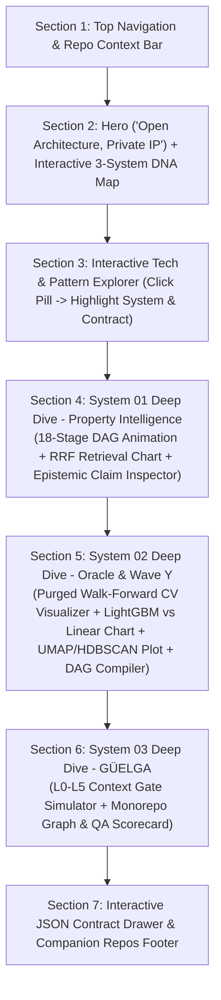

# Architecture Showcase Companion Landing Page: Structure, Visual Specs & English Copy

**Purpose:** Design and copywriting blueprint for the interactive companion site to [`https://github.com/myasnikoviv/Architecture-showcase`](https://github.com/myasnikoviv/Architecture-showcase).
**Target Readers:** Technical Recruiters verifying deep tech stack claims and CTOs / Hiring Managers / Staff Engineers evaluating systems engineering, ML validation rigor, and frontend governance beyond static GitHub Markdown.
**Core Framing:** *Open Architecture, Private IP.* Proprietary datasets, commercial scraping targets, local market pricing rules, and trading parameters remain private, while every engineering architecture, validation invariant, interactive data flow, and sanitized JSON contract is inspectable here.

---

## Page Information Architecture & Interactive Flow

---

## Section 1: Top Navigation & Context Bar

**UI Layout:** Sticky top header linking across the three systems, the technology explorer, the inline contract inspector, and the GitHub source repository.

**Copy:**
* **Brand Title:** `Engineering Architecture Showcase`
* **Subtitle Badge:** `Interactive Systems & Contracts Companion`
* **Navigation Links:** `Overview` · `Tech Explorer` · `01. Property Intelligence` · `02. Oracle & Wave Y` · `03. GÜELGA` · `Contracts`
* **Header Action Buttons:**
  * `GitHub Showcase` -> [`https://github.com/myasnikoviv/Architecture-showcase`](https://github.com/myasnikoviv/Architecture-showcase)
  * `Open Multi-Agent Repo` -> [`https://github.com/myasnikoviv/Agents-system`](https://github.com/myasnikoviv/Agents-system)
  * `Author Portfolio` -> *(link to Ilia's existing personal developer landing page)*

---

## Section 2: Hero ("Open Architecture, Private IP")

**UI Layout:** Split hero. Left side presents the rationale for the showcase, concise summary, and action buttons. Right side renders an **Animated Cross-System Architecture Map** linking the 3 systems (`Property Intelligence`, `Oracle & Wave Y`, `GÜELGA`) to four shared engineering primitives (`Deterministic Orchestration`, `Fail-Closed Contracts`, `SHA-256 Provenance`, `Leakage-Free Offline Evals`).

### English Copy

**Eyebrow Tag:**
`SYSTEMS ARCHITECTURE · QUANTITATIVE ML · AI CONTEXT GOVERNANCE`

**H1 Headline:**
`Three private R&D systems, unpacked down to the data contracts, validation loops, and ML pipelines.`

**Subheadline:**
`Commercial real-estate intelligence, quantitative time-series research, and proprietary design systems rarely ship as open-source repos. This showcase bridges that gap: explore the interactive architecture, animated execution flows, and sanitized JSON contracts behind Property Intelligence, Oracle & Wave Y (Trade Bot), and GÜELGA.`

**Primary CTAs:**
* `Explore System 01` (scrolls to `#property-intelligence`)
* `Filter by Technology` (scrolls to `#tech-explorer`)
* `Inspect Markdown & Schemas on GitHub` -> [`https://github.com/myasnikoviv/Architecture-showcase/blob/main/README.md`](https://github.com/myasnikoviv/Architecture-showcase/blob/main/README.md)

**Verified Codebase Scale Strip (5 Metric Counters):**
1. **`200` JSON Schema Contracts** (`Property Intelligence` data & validation boundary)
2. **`563` Automated Test Files** (`pytest` & `unittest` semantic conservation checks)
3. **`18` Deterministic DAG Stages** (checkpointed `SingleActionStage` & `ItemSequenceStage` runtime)
4. **`30+` Point-in-Time ML Features** (`LightGBM`, `UMAP`, `HDBSCAN` with purged walk-forward CV)
5. **`6` React 19 Monorepo Packages** (`@guelga/*` design system + `L0-L5` AI retrieval gates)

### Interactive Visual Spec 2A: Animated Cross-System Architecture Map
* **Visual Behavior:** SVG node-link graph where hovering over one of the 4 shared invariants (`Deterministic Orchestration`, `Fail-Closed Contracts`, `SHA-256 Provenance`, `Leakage-Free Offline Evals`) illuminates animated signal pulses traveling into the corresponding subsystems of all 3 projects.

---

## Section 3: Interactive Technology & Pattern Explorer

**UI Layout:** A filterable technology explorer designed for rapid technical verification. Clicking any technology pill highlights which of the 3 systems uses it, displays a 1-line explanation of *how* it is used, and provides a direct link to the exact GitHub case study or contract file.

### English Copy

**Section Heading:**
`Inspect the Stack Inside Real Architecture`

**Section Intro:**
`Click any technology or engineering pattern below to trace where it runs, why it was chosen over simpler alternatives, and which contract enforces it.`

**5 Filter Categories & Technology Pills:**

1. **Machine Learning & Quantitative Validation:**
   * `LightGBM 4.6 (LGBMClassifier / LGBMRegressor)` -> `Trade Bot (Oracle)`
   * `Scikit-Learn 1.9 (LogisticRegression, StandardScaler, SimpleImputer)` -> `Trade Bot (Oracle)`
   * `UMAP + HDBSCAN 0.8.33 + SciPy` -> `Trade Bot (Wave Y)`
   * `Purged Walk-Forward & Episode-Grouped CV` -> `Trade Bot (Oracle)`
   * `Feature Ablation & Counterfactual Attribution` -> `Trade Bot (Wave Y)`
2. **Hybrid Search, Embeddings & Vision AI:**
   * `Tantivy 0.26.2 (Rust BM25)` -> `Property Intelligence`
   * `ONNX Runtime 1.31.0 (intfloat/multilingual-e5-small 384-d)` -> `Property Intelligence`
   * `HuggingFace tokenizers 0.23.3` -> `Property Intelligence`
   * `Reciprocal Rank Fusion (RRF k=60)` -> `Property Intelligence`
   * `Beam Search Ensemble Optimizer` -> `Property Intelligence`
   * `Gemini Vision API` -> `Property Intelligence`
   * `Manhattan-World Camera Calibration` -> `Property Intelligence`
3. **Data Engineering & Geospatial OSINT:**
   * `DuckDB 1.5 (httpfs + spatial)` -> `Property Intelligence` & `Trade Bot`
   * `Apache Arrow / PyArrow 16.1 + Parquet` -> `Trade Bot`
   * `Pandas + NumPy` -> `Trade Bot`
   * `PostgreSQL (pg / psycopg2)` -> `Trade Bot`
   * `Redis (ioredis) + SQLite (better-sqlite3)` -> `Trade Bot`
   * `Shapely 2.0 + Haversine / IDW` -> `Property Intelligence`
   * `Overture Maps + Google Places/POI + Catastro / INE / IGN` -> `Property Intelligence`
4. **Orchestration, Compilers & Governance:**
   * `18-Stage Python DAG Orchestrator` -> `Property Intelligence`
   * `JSON Schema (200 contracts) + AJV` -> `Property Intelligence` & `Trade Bot`
   * `TypeScript AST Node-Graph Compiler` -> `Trade Bot`
   * `L0-L5 Progressive Context Retrieval Gate` -> `GÜELGA`
   * `SHA-256 Artifact & Dataset Pinning` -> `All 3 Systems`
5. **Frontend, Visualization & Automated QA:**
   * `React 18 & 19 + TypeScript 5.9 + Vite` -> `All 3 Systems`
   * `NPM Workspaces Monorepo (@guelga/*)` -> `GÜELGA`
   * `Tailwind CSS v4 + Motion` -> `Property Intelligence` & `GÜELGA`
   * `@xyflow/react (React Flow v12) + Dagre + Zustand` -> `Trade Bot`
   * `TradingView Lightweight Charts` -> `Trade Bot`
   * `Layered SVG 2D Floorplan Projection` -> `Property Intelligence`
   * `Playwright (CDP & Headless) + Axe-core (WCAG)` -> `Property Intelligence` & `GÜELGA`

---

## Section 4: System 01 Deep Dive: `Property Intelligence`

### English Copy

**Header & Tags:**
* **System ID:** `01 / PROPERTY INTELLIGENCE`
* **Title:** `Geospatial OSINT, Multimodal Vision & Zero-Network Hybrid Search Engine`
* **Scale:** `255` Python Scripts · `200` JSON Schema Contracts · `563` Test Files (`pytest`/`unittest`) · `28` ADRs · Decoupled `React 19` Presentation Layer

**Why This Project Exists:**
`Property Intelligence was built to automate technical real-estate audits, neighborhood context scoring, and interior furnishing recommendations across Spanish residential listings. Standard LLM wrappers fail immediately in this domain: vision models misread wide-angle distortion, unstructured prompts mutate factual portal numbers, missing government raster data (NoData) gets hallucinated as "safe," and hosted vector APIs add latency and cost during multi-item interior optimization.`

`The architecture replaces free-form agent loops with an 18-stage deterministic Python pipeline wrapped around strict epistemic contracts and zero-network local search.`

**How the Architecture Works (4 Subsystem Tabs):**

1. **18-Stage Deterministic DAG Orchestrator (`S01`–`S18`)**
   * `Every step inherits from StageContract (SingleActionStage or ItemSequenceStage), logging structured execution spans through StageLogger and persisting granular state inside CheckpointManager and job_ledger.`
   * `When an upstream LLM or acquisition adapter drops a field or hits rate limits, provider_recovery and contract_repairs isolate the failure, repair schema violations deterministically, and resume from the exact failed item without rerunning expensive vision calls.`
2. **6-Tier Epistemic Hierarchy & Anti-Hallucination Gate**
   * `Every claim emitted by the pipeline carries an explicit epistemic_class (CANONICAL_FACT -> DETERMINISTIC_DERIVATION -> MODEL_OBSERVATION -> MODEL_ASSESSMENT -> RISK_HYPOTHESIS -> RECOMMENDED_ACTION), a status (OBSERVED | UNKNOWN | UNAVAILABLE), and a SHA-256 provenance reference.`
   * `During synthesis, model_metadata.web_access is locked to false. A deterministic SemanticConservationValidator rejects any output that mutates observed inputs, converts missing raster values (e.g., flood GRAY_INDEX: 999) into negative safety claims, or invents unbacked percentage lifts.`
3. **Zero-Network Local Hybrid Search & Beam Search Optimizer**
   * `To match room gaps against an interior product catalogue without hosted vector databases or external embedding calls, hybrid_catalogue_index.py runs two local lanes side by side: Tantivy 0.26.2 (Rust BM25) and ONNX Runtime 1.31.0 executing intfloat/multilingual-e5-small (384-d embeddings via attention-mask mean pooling and L2 normalization).`
   * `Before loading weights, the runtime resolves Hugging Face's content-addressed cache and checks exact SHA-256 digests for model.onnx, tokenizer.json, and config files. Both top-100 candidate sets merge via Reciprocal Rank Fusion (k=60) with deterministic tie-breaking, feeding a Beam Search optimizer that scores spatial fit, clearance, and palette continuity across multi-item room ensembles.`
4. **Geospatial OSINT, Computer Vision & Decoupled React 19 UI**
   * `Spatial ingestion combines DuckDB (httpfs + spatial) queries over Overture Maps, Shapely 2.0 geometry, cost-gated Google Places/POI calls, and official Spanish data sources (Catastro, INE ADRH census statistics, IGN/MITECO environmental layers).`
   * `Visual processing runs persistent Playwright CDP harvesting, Manhattan-world wide-angle camera auto-calibration, a 2D spatial clearance linter, and layered SVG floorplan composition. A standalone React 19 + TypeScript + Vite + Tailwind v4 frontend consumes only pre-validated view-model JSON via sync-listing-data.mjs.`

**Direct GitHub Links for This System:**
* [`Read Full Case Study & 4 Mermaid Diagrams`](https://github.com/myasnikoviv/Architecture-showcase/blob/main/case-studies/01-property-intelligence-geospatial-ai-pipeline.md)
* [`Inspect Contract: epistemic-forensic-proposition.schema.json`](https://github.com/myasnikoviv/Architecture-showcase/blob/main/contracts/epistemic-forensic-proposition.schema.json)
* [`Inspect Contract: hybrid-retrieval-bundle.schema.json`](https://github.com/myasnikoviv/Architecture-showcase/blob/main/contracts/hybrid-retrieval-bundle.schema.json)

### Interactive Visual, Animation & Chart Specs (Section 4)

1. **Animation 4A: 18-Stage DAG Stepper & Self-Healing Loop:**
   * *Interactive Controls:* `Play Happy Path` / `Simulate Schema Drift` / `Step S01..S18`.
   * *Behavior:* Animated packet moves through `Acquisition -> Vision -> Geospatial -> Synthesis -> Validator`. In failure mode, the packet turns amber at `SemanticConservationValidator`, triggers `contract_repairs`, and resumes from `CheckpointManager` without re-invoking upstream vision stages.
2. **Chart 4B: Hybrid Retrieval & Typed Facet Ablation Explorer:**
   * *Chart Type:* Interactive grouped bar + rank-fusion comparison chart (using illustrative normalized recall/rank deltas from the architecture).
   * *Behavior:* Toggles between `BM25 Only (Tantivy)`, `Dense Only (ONNX E5 384-d)`, `RRF Fusion (k=60)`, and `RRF + Beam Search Rerank`, showing how lexical precision on SKU/material attributes pairs with semantic multilingual recall.
3. **Widget 4C: Live Epistemic Claim Validator Demo:**
   * *Behavior:* Two toggleable JSON payloads side-by-side (`Valid Provenance-Bound Claim` vs. `Blocked Hallucination: Flood NoData Inverted / Energy Rating Dropped`) showing exactly why the validator passes one and fail-closed rejects the other.

---

## Section 5: System 02 Deep Dive: `Trade Bot (Oracle & Wave Y)`

### English Copy

**Header & Tags:**
* **System ID:** `02 / TRADE BOT (ORACLE & WAVE Y)`
* **Title:** `Quantitative ML Research, Market Regime Discovery, Visual DAG Compiler & 1:1 Replay Platform`
* **Scale:** `24` TypeScript Domain Modules · `100+` Python ML & Research Scripts · Dual `Python DS` + `TypeScript/Node.js` Architecture · `React 18` Node-Graph Cockpit

**Why This Project Exists:**
`Algorithmic trading research usually breaks in four predictable ways: standard cross-validation leaks overlapping future price windows into training sets; strategy logic written in Python notebooks diverges from TypeScript execution code; gradient-boosted trees overfit noisy features without calibrated linear benchmarks; and static thresholds collapse when market regimes shift.`

`Trade Bot was built as a strict, leakage-proof research and replay platform where ML models, unsupervised regime mining, visual graph compilation, and execution parity share deterministic contracts. (Note: All public materials document ML methodology and systems engineering only; no commercial trading profitability claims are made.)`

**How the Architecture Works (4 Subsystem Tabs):**

1. **Columnar & Relational Lakehouse with Lineage Pinning**
   * `Market data ingests strictly from Binance USD-M Futures APIs and Vision archives into SHA-256 pinned Parquet corpora. Analytical workloads run directly on DuckDB 1.5.5, PyArrow 16.1, Pandas, and NumPy, while discovery_dataset_rows, trade lifecycle snapshots, and optimizer queues persist in PostgreSQL, SQLite (better-sqlite3), and Redis (ioredis).`
2. **Oracle Supervised ML & Purged Walk-Forward Validation**
   * `Inside the Oracle pipeline, LightGBM 4.6 (LGBMClassifier and LGBMRegressor with depth/leaf complexity constraints) challengers benchmark directly against Scikit-Learn 1.9 baselines (SimpleImputer -> StandardScaler -> LogisticRegression) and historical priors.`
   * `To block lookahead bias completely, expanding temporal quantile splits enforce outcomeAvailableAt < fold_start with a PURGE_4H_MS embargo buffer and episode grouping (symbol|episodeId). A programmatic assertion aborts any run if set(train.group) & set(test.group) is non-empty. Models are evaluated on out-of-sample ROC-AUC, Log-Loss calibration, and net-of-cost replay including fees, slippage, funding, and drawdown.`
3. **Wave Y Unsupervised Market Regime Discovery**
   * `Instead of hand-coding arbitrary volatility cutoffs, Wave Y scales 30+ point-in-time microstructural and cross-asset features (trend persistence, structural churn, taker buy/sell imbalance, volatility compression, BTC/ETH leadership, and sector relative strength) strictly on in-sample cutoffs.`
   * `Features project through UMAP into HDBSCAN 0.8.33 density clusters with explicit noise isolation, followed by feature ablation (hl02), radius sensitivity sweeps (hl01), counterfactual attribution, and out-of-sample portability validation.`
4. **Visual DAG Strategy Compiler & 1:1 Replay Parity**
   * `On the frontend, a visual node-graph editor built with React 18, @xyflow/react (React Flow v12), Dagre, Zustand, and TradingView Lightweight Charts compiles visual strategy graphs through AJV JSON Schema validation and updateBlockLogicManifest.ts checks into deterministic runtime ASTs.`
   * `Backtesting, historical replay harnesses (proc204 and proc206), paper simulation, and live runtime (Express 5, WebSockets ws, CCXT) execute the exact same decision kernel, with mode differences confined strictly to clock and broker adapters.`

**Direct GitHub Links for This System:**
* [`Read Full Case Study & 4 Mermaid Diagrams`](https://github.com/myasnikoviv/Architecture-showcase/blob/main/case-studies/02-oracle-quantitative-ml-and-replay-platform.md)

### Interactive Visual, Animation & Chart Specs (Section 5)

1. **Animation 5A: Purged Walk-Forward vs. Standard K-Fold Leakage Visualizer:**
   * *Interactive Controls:* Toggle `Naive K-Fold (Leaks)` vs. `Purged Episode-Grouped Walk-Forward (Clean)` + scrubber across Folds 1 to 4.
   * *Behavior:* Shows overlapping episode bars across a time axis. Under `Naive K-Fold`, future `outcomeAvailableAt` intervals bleed red across fold borders. Under `Purged Walk-Forward`, the `PURGE_4H_MS` embargo zone illuminates and excludes overlapping `symbol|episodeId` rows before `fold_start`.
2. **Chart 5B: Challenger vs. Baseline Out-of-Sample Evaluation Matrix:**
   * *Chart Type:* Interactive dual-metric chart comparing `Prior Baseline`, `Direction-Only Linear`, `Full Linear (LogisticRegression)`, and `LightGBM Challenger` across `Out-of-Sample ROC-AUC` and `Log-Loss Calibration` across sequential folds, illustrating why non-linear trees must prove lift over calibrated linear baselines.
3. **Interactive Plot 5C: Wave Y 30-Feature UMAP + HDBSCAN Cluster Map & DAG-to-AST Compiler Animation:**
   * *Behavior:* Interactive 2D scatter cluster diagram showing density-separated market regimes vs. HDBSCAN noise points, paired with a toggleable `Feature Ablation` bar view and a mini node-graph (`Market Feature -> Gate -> Risk Rule`) animating its compilation into a validated `AJV` AST block.

---

## Section 6: System 03 Deep Dive: `GÜELGA`

### English Copy

**Header & Tags:**
* **System ID:** `03 / GÜELGA`
* **Title:** `AI-Governed React 19 Design System Monorepo & Progressive Context Retrieval Architecture`
* **Scale:** `6` NPM Workspace Packages (`@guelga/*`) · `3` React 19 Applications · `11` Approval Gates · `70` Engineering & Continuity Tickets (`DS-R01`..`DS-R56`, `T28-CR01`..`T28-CR14`)

**Why This Project Exists:**
`Scaling a multi-application React design system with AI coding agents exposes two subtle failure modes: loading entire brand manuals, rejected prototypes, and historical audits into the prompt causes "context rot" that pulls outputs toward generic SaaS templates; meanwhile, visual tokens and Figma/HTML documentation quietly drift away from real component behavior and WCAG accessibility standards.`

`GÜELGA solves this by combining a modular NPM Workspaces React 19 monorepo with a deterministic L0-L5 Progressive Context Retrieval Policy and automated multi-viewport Playwright + Axe-core release verification.`

**How the Architecture Works (3 Subsystem Tabs):**

1. **6-Package NPM Workspaces Design System Monorepo (`@guelga/*`)**
   * `Six versioned internal packages (@guelga/tokens, @guelga/styles, @guelga/icons, @guelga/locales supporting EN/ES/AST, @guelga/motion-react, and @guelga/react) feed three live React 19 applications: @guelga/docs (an interactive Widgetbook and component state parity inspector), apps/web, and apps/fluxu-journey-prototype (implementing a Journey Continuity State Graph across shared layout transitions).`
2. **L0-L5 Progressive AI Context Retrieval Gate & 5-Persona Role Routing**
   * `GUELGA_DESIGN_RETRIEVAL_POLICY_v1.json enforces strict layered permissions: an agent boots only with L0 (constitution, retrieval policy, authority manifest, active ticket extract), retrieves targeted L1 design principles and L2 canonical demonstrations, and stops at one of 11 Human Visual Approval Gates before L3 (@guelga/tokens and React APIs) or L4 (QA checks) unlock.`
   * `Five isolated role playbooks (brand-strategist, art-director, ui-ux-designer, design-system-engineer, qa-editor) prevent simulated self-approval, while L5 (legacy Ticket 28 history) requires an explicit forensic summons and L6 (dist/, node_modules/, unapproved drafts) stays permanently blocked.`
3. **Deterministic Release & Accessibility QA Pipeline (`verify_exploration.sh`)**
   * `Every candidate package runs through automated Playwright desktop and mobile visual captures, Axe-core WCAG accessibility audits, PDF contact sheet verification, byte-identical source comparison (cmp -s) on vector brand marks, and SHA-256 hash pinning across licensed typography files.`

**Direct GitHub Links for This System:**
* [`Read Full Case Study & 3 Mermaid Diagrams`](https://github.com/myasnikoviv/Architecture-showcase/blob/main/case-studies/03-guelga-design-system-and-context-governance.md)
* [`Inspect Contract: l0-l5-context-retrieval-policy.json`](https://github.com/myasnikoviv/Architecture-showcase/blob/main/contracts/l0-l5-context-retrieval-policy.json)

### Interactive Visual & Animation Specs (Section 6)

1. **Animation 6A: Interactive `L0–L5` Context Retrieval Gate Simulator:**
   * *Interactive Controls:* Select Ticket Phase (`Brand Discovery`, `Visual Direction Pending Gate`, `Approved Component Implementation`, `Release QA`) + Role Persona.
   * *Behavior:* Highlights which layers (`L0..L6`) light up green (`Permitted`), amber (`Requires Human Gate / Forensic Summons`), or red (`Blocked Noise / Generic Skill Isolated`), making context governance immediately tangible.
2. **Diagram 6B: `@guelga/*` Monorepo Dependency Graph & Release QA Scorecard:**
   * *Behavior:* Interactive package dependency tree showing tokens flowing into `@guelga/react`, `@guelga/docs`, `apps/web`, and `fluxu-journey-prototype`, paired with a live-style QA pass/fail gate checklist (`Playwright Multi-Viewport`, `Axe-core WCAG`, `SVG Byte-Parity`, `SHA-256 Typography Hashes`).

---

## Section 7: Interactive JSON Contracts Inspector & Companion Repositories

**UI Layout:** A dark syntax-highlighted tabbed code viewer allowing visitors to inspect the 3 sanitized contracts inline without leaving the page, alongside direct "Open Raw on GitHub" buttons and a cross-link to the open-source `Agents-system` TypeScript/LangGraph monorepo.

### English Copy

**Section Heading:**
`Inspect the Enforcement Contracts Directly`

**Section Intro:**
`Prompts suggest behavior; schemas and policy manifests enforce it. Browse the sanitized reference contracts below or open the full repository on GitHub.`

**3 Contract Tabs:**
1. **`epistemic-forensic-proposition.schema.json`** -> [`Open on GitHub`](https://github.com/myasnikoviv/Architecture-showcase/blob/main/contracts/epistemic-forensic-proposition.schema.json)
   * *Caption:* `Locks synthesis models to web_access: false and enforces explicit epistemic_class, evidence_refs, and UNKNOWN/UNAVAILABLE state preservation.`
2. **`hybrid-retrieval-bundle.schema.json`** -> [`Open on GitHub`](https://github.com/myasnikoviv/Architecture-showcase/blob/main/contracts/hybrid-retrieval-bundle.schema.json)
   * *Caption:* `Pins Tantivy 0.26.2 + ONNX Runtime 1.31.0 (multilingual-e5-small), verifies SHA-256 Hugging Face blob hashes, and bans silent single-lane fallbacks.`
3. **`l0-l5-context-retrieval-policy.json`** -> [`Open on GitHub`](https://github.com/myasnikoviv/Architecture-showcase/blob/main/contracts/l0-l5-context-retrieval-policy.json)
   * *Caption:* `Separates design principles, human approval gates, implementation tokens, and excluded build noise so multi-agent workflows resist context rot.`

**Footer Banner:**
* **Headline:** `Want to inspect live TypeScript + LangGraph orchestration code alongside these architecture blueprints?`
* **CTA 1:** `Explore Architecture-showcase on GitHub` -> [`https://github.com/myasnikoviv/Architecture-showcase`](https://github.com/myasnikoviv/Architecture-showcase)
* **CTA 2:** `Explore Open-Source Agents-system Monorepo (630+ files, 174 Jest suites)` -> [`https://github.com/myasnikoviv/Agents-system`](https://github.com/myasnikoviv/Agents-system)
* **CTA 3:** `Visit Main Developer Portfolio` -> *(Author's existing site link)*
